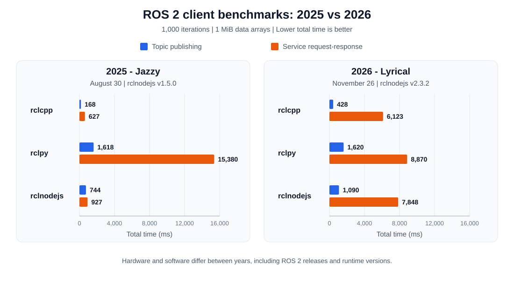

# ROS 2 Client Library Benchmarks

Topic and service benchmarks for rclcpp (C++), rclpy (Python), and rclnodejs (JavaScript).

## Results

Each run uses 1000 publishes or service responses with 1024 KiB (1 MiB) data arrays. Times are total milliseconds, not per-message latencies. Ratios use each table's C++ baseline.



### November 26, 2026 (Lyrical)

- Host: Ubuntu 26.04.1 LTS (WSL2), x86_64; AMD EPYC 7763, 16 logical CPUs, 31.3 GiB VM RAM
- ROS 2 Lyrical: rclcpp 32.0.3, rclpy 10.0.11
- Middleware: `rmw_fastrtps_cpp` 9.4.10 (Fast DDS)
- Runtimes: GCC 15.2.0, Python 3.14.4, Node.js v26.13.1; published [rclnodejs v2.3.2](https://www.npmjs.com/package/rclnodejs/v/2.3.2) with its Lyrical prebuilt addon
- C++ runners: C++20, default build type (no optimization flags)

Values are median (min-max) from the final five-run calibration batch.

| Client Library | Topic (ms) | Service (ms) | Time / C++ (topic / service) |
| --- | --- | --- | --- |
| rclcpp (C++) | 428 (400-452) | 6,123 (3,096-6,202) | Baseline |
| rclpy (Python) | 1,620 (1,609-1,641) | 8,870 (8,821-9,348) | 3.8x / 1.4x |
| rclnodejs (Node.js) | 1,090 (1,017-1,203) | 7,848 (7,128-8,377) | 2.5x / 1.3x |

### August 30, 2025 (Jazzy)

Original recorded totals, retained for trend tracking:

- Host: Ubuntu 24.04.3 LTS (WSL2), x86_64; Intel Core i7-1185G7 (4 cores, 8 threads), 8GB RAM
- ROS 2: [Jazzy Patch Release 6](https://github.com/ros2/ros2/releases/tag/release-jazzy-20250820)
- Runtimes: GCC 13.3.0, Python 3.12.3, Node.js v22.18.0; [rclnodejs v1.5.0](https://www.npmjs.com/package/rclnodejs/v/1.5.0)

| Client Library | Topic (ms) | Service (ms) | Time / C++ (topic / service) |
| --- | --- | --- | --- |
| rclcpp (C++) | 168 | 627 | Baseline |
| rclpy (Python) | 1,618 | 15,380 | 9.6x / 24.5x |
| rclnodejs (Node.js) | 744 | 927 | 4.4x / 1.5x |

## Running Benchmarks

### Environment and C++ Build

Run from the repository root with ROS 2 Lyrical, the [C++ build dependencies](./rclcpp/CMakeLists.txt), `cmake`, and `build-essential`.

Use these settings in both terminals, choosing the same unused domain ID:

```bash
source /opt/ros/lyrical/setup.bash
export RMW_IMPLEMENTATION=rmw_fastrtps_cpp
export ROS_AUTOMATIC_DISCOVERY_RANGE=LOCALHOST
export ROS_DOMAIN_ID=91
```

Build the recorded C++ configuration:

```bash
cmake -S benchmark/rclcpp -B benchmark/rclcpp/build -DCMAKE_CXX_STANDARD=20 -DCMAKE_BUILD_TYPE=
cmake --build benchmark/rclcpp/build
```

Run one pair at a time: start terminal 1 first, then terminal 2. `-s` sets data size in KiB; `-r` sets iterations.

### Using the Published rclnodejs Package

Install v2.3.2 in a temporary directory, keeping the checkout unchanged:

```bash
BENCHMARK_DIR=$(mktemp -d)
npm install --prefix "$BENCHMARK_DIR" rclnodejs@2.3.2 commander@15.0.0
npm pkg set --prefix "$BENCHMARK_DIR" type=module
mkdir -p "$BENCHMARK_DIR/benchmark"
cp -R benchmark/rclnodejs "$BENCHMARK_DIR/benchmark/"
printf "export { default } from 'rclnodejs';\n" > "$BENCHMARK_DIR/index.js"
printf '%s\n' "$BENCHMARK_DIR"
```

In both terminals, `cd` to the printed directory, then run the JavaScript commands below. Keep using the repository root for C++ and Python.

### Topics

Message type: `std_msgs/msg/UInt8MultiArray`.

| Library | Terminal 1: subscriber | Terminal 2: publisher |
| --- | --- | --- |
| rclcpp | `benchmark/rclcpp/build/subscription-stress-test` | `benchmark/rclcpp/build/publisher-stress-test -r 1000 -s 1024` |
| rclpy | `python3 benchmark/rclpy/topic/subscription-stress-test.py` | `python3 benchmark/rclpy/topic/publisher-stress-test.py -r 1000 -s 1024` |
| rclnodejs | `node benchmark/rclnodejs/topic/subscription-stress-test.js` | `node benchmark/rclnodejs/topic/publisher-stress-test.js -r 1000 -s 1024` |

### Services

Service type: `nav_msgs/srv/GetMap`.

| Library | Terminal 1: service | Terminal 2: client |
| --- | --- | --- |
| rclcpp | `benchmark/rclcpp/build/service-stress-test -s 1024` | `benchmark/rclcpp/build/client-stress-test -r 1000` |
| rclpy | `python3 benchmark/rclpy/service/service-stress-test.py -s 1024` | `python3 benchmark/rclpy/service/client-stress-test.py -r 1000` |
| rclnodejs | `node benchmark/rclnodejs/service/service-stress-test.js -s 1024` | `node benchmark/rclnodejs/service/client-stress-test.js -r 1000` |
