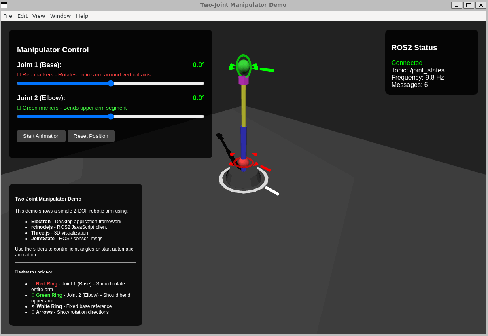

# Electron Manipulator Demo

Move a simulated two-joint arm in a Three.js view. The app publishes and receives `sensor_msgs/msg/JointState` on `/joint_states`.



## Run

After [Electron setup](../README.md#setup), run from the repository root:

```bash
cd demo/electron/manipulator
npm install
npm start
```

Move the sliders or click **Start Animation**. **Reset Position** returns both joints to zero. Drag to orbit and scroll to zoom.

## Inspect Joint States

The app publishes `joint1` and `joint2` positions in radians at 10 Hz. In another terminal with ROS sourced:

```bash
ros2 topic echo /joint_states sensor_msgs/msg/JointState
```

For a standalone build, see [packaging](../README.md#package-a-demo).