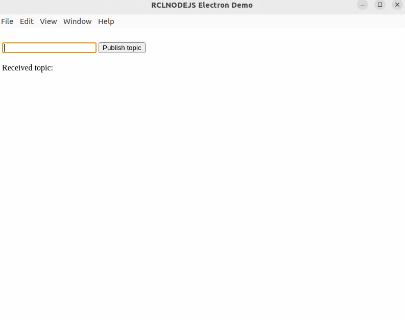

# Electron Topics Demo

Send and receive `std_msgs/msg/String` messages on `/topic` from a desktop window. The ROS 2 node is `/publisher_example_node`.



## Run

After [Electron setup](../README.md#setup), run from the repository root:

```bash
cd demo/electron/topics
npm install
npm start
```

Type a message and click **Send**. The window shows messages it receives on `/topic`.

In another terminal with ROS sourced, watch the messages:

```bash
ros2 topic echo /topic std_msgs/msg/String
```

For a standalone build, see [packaging](../README.md#package-a-demo).