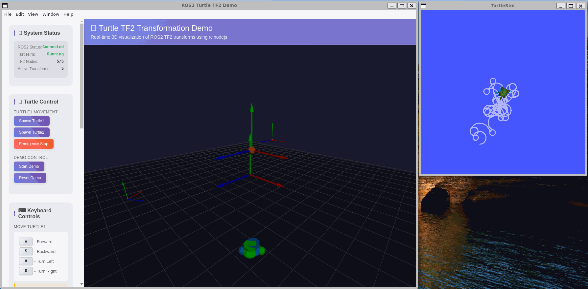

# Electron Turtle TF2 Demo

Watch TurtleSim coordinate frames in a Three.js view and make `turtle2` follow `turtle1`.



## Run

Use the [Electron setup](../README.md#setup) with ROS 2 Humble or Jazzy and the `turtlesim` package. The demo uses `turtlesim/msg/Pose` and `turtlesim/srv/Spawn`. Kilted, Lyrical, and Rolling put those interfaces in `turtlesim_msgs` instead.

In one terminal with ROS sourced, start TurtleSim:

```bash
ros2 run turtlesim turtlesim_node
```

Source the same ROS installation in a second terminal and run from the repository root:

```bash
cd demo/electron/turtle_tf2
npm install
npm start
```

Click **Start Demo**, then **Spawn Turtle2**. Click the 3D view and drive `turtle1` with WASD. `turtle2` follows. Drag to orbit and scroll to zoom.

## Inspect Transforms

`carrot1_dynamic` orbits `carrot1_static`, which is fixed in `world`. `carrot1_fixed` moves with `turtle1`. Watch the transforms in another ROS-sourced terminal:

```bash
ros2 topic echo /tf tf2_msgs/msg/TFMessage
```

For a standalone build, see [packaging](../README.md#package-a-demo).