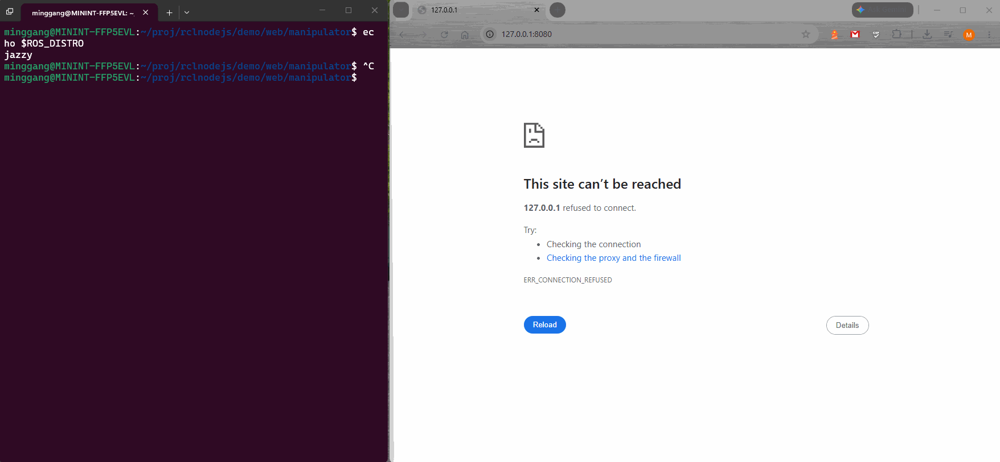

# Manipulator Studio

A simulated two-joint arm controlled from your terminal and visualized in a
browser. No Electron required; this demo does not control real hardware.



## Requirements

- Node.js >=20.20.2 and a supported ROS 2 installation on the terminal machine.
- A checkout of this repository.
- A browser with WebGL support.

## Run

```bash
source /opt/ros/jazzy/setup.bash # replace jazzy with your distro
cd /path/to/rclnodejs
npm install

cd demo/web/manipulator
npm install
npm start
```

Open **http://127.0.0.1:8080/** in a browser with WebGL support, then return
keyboard focus to the terminal. Keep `npm start` running while using the demo.

If ports 8080 or 9000 are occupied, choose different ports:

```bash
STATIC_PORT=8081 RUNTIME_PORT=9010 npm start
```

Then open **http://127.0.0.1:8081/**.

## Controls

| Terminal keys | Action |
| --- | --- |
| A / D or Left / Right | Rotate the base |
| S / W or Down / Up | Bend the elbow |
| Space | Toggle automatic motion |
| R | Reset the arm |
| H | Show help |
| Q / Escape / Ctrl+C | Quit |

In the browser, drag to orbit or pan, scroll to zoom, and click **Reset view**
to restore the camera. Arm movement is controlled only from the terminal.
