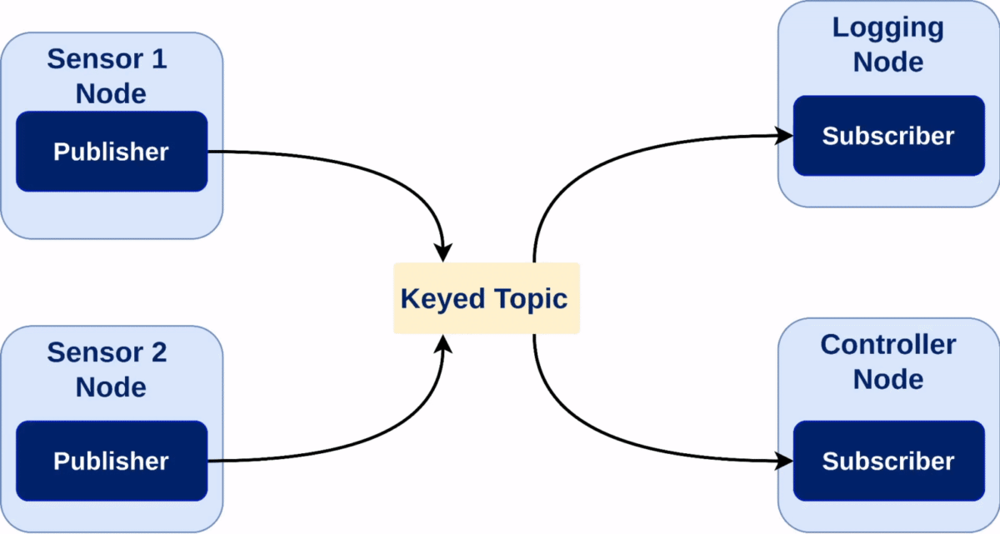

# Content-Filtered Subscriptions

A content filter tells the middleware which messages a subscription wants. Only matching messages reach its callback. This is different from filtering in JavaScript after a message has already been received and converted.

Content filtering requires ROS 2 Humble or newer and an RMW implementation that supports it. Support depends on the RMW and its version; excluding one unsupported implementation is not a sufficient capability check. The example below can be run with Fast DDS.

Use the project from [Writing Your First rclnodejs Nodes](writing-your-first-rclnodejs-nodes.md), with ROS sourced in each terminal.

## Write the Subscriber

Create `filtered-subscriber.mjs`:

```javascript
import rclnodejs from 'rclnodejs';

await rclnodejs.init();
const node = rclnodejs.createNode('filtered_listener');
console.log(`RMW: ${node.getRMWImplementationIdentifier()}`);

const subscription = node.createSubscription(
  'std_msgs/msg/Int32',
  'numbers',
  {
    contentFilter: {
      expression: 'data >= %0 AND data <= %1',
      parameters: ['10', '50'],
    },
  },
  (message) => console.log(`Received: ${message.data}`)
);

if (!subscription.hasContentFilter()) {
  rclnodejs.shutdown();
  throw new Error('The requested content filter is not active');
}

console.log('Filter active on /numbers');
rclnodejs.spin(node);
```

The field `data` comes from `std_msgs/msg/Int32`. `%0` and `%1` refer to the first and second filter parameters. This filter accepts values from 10 through 50, including both endpoints.

Creating or updating a filter can fail on unsupported middleware or invalid syntax. Do not silently fall back to an unfiltered subscription if your application relies on the filter.

## Publish Matching and Nonmatching Values

Start the subscriber:

```bash
node filtered-subscriber.mjs
```

In another terminal:

```bash
ros2 topic pub /numbers std_msgs/msg/Int32 '{data: 5}' --once
ros2 topic pub /numbers std_msgs/msg/Int32 '{data: 15}' --once
ros2 topic pub /numbers std_msgs/msg/Int32 '{data: 60}' --once
```

Only `Received: 15` should appear. Keep the subscriber running while sending all three messages; discovery must complete before a publisher can deliver them.



The subscriber receives only the readings selected by its filter. Whether this also reduces network traffic depends on where the DDS implementation evaluates the filter and which transport it uses; it is not guaranteed by the JavaScript API.

## Change the Filter

The subscription can keep running while you replace its filter:

```javascript
if (
  !subscription.setContentFilter({
    expression: 'data > %0',
    parameters: ['25'],
  })
) {
  throw new Error('Could not update the content filter');
}

console.log(subscription.getContentFilter());
```

Add this code where your application handles a configuration change. Future matching messages use the new expression; a filter update does not retract callbacks already delivered to JavaScript.

To receive all values again:

```javascript
if (!subscription.clearContentFilter()) {
  throw new Error('Could not clear the content filter');
}
```

`hasContentFilter()` reports whether a filter is active. On Lyrical and newer, `isContentFilterSupported()` provides a separate subscription capability check. On older distros, do not interpret that newer capability API's `false` result as proof that an active filter is unsupported.

## Write Filter Expressions

Use DDS filter syntax, not JavaScript: comparisons such as `data > %0` and conditions joined with `AND` or `OR`. Operators such as `===` and `!==` are not valid replacements.

Pass parameters as strings. A numeric threshold can be `'25'`; a string literal must include its SQL quotes, such as `"'base_link'"`. The referenced field must exist in the message type. Do not assume that functions, nested fields, or array expressions are supported by every DDS implementation.

Filters are subscription preferences, not access control. Another subscriber can request the unfiltered topic.

Press **Ctrl+C** to stop the example. In a longer-running application, release an individual subscription with `node.destroySubscription(subscription)` when it is no longer needed.

## Further Reading

- [Observable subscriptions](observable-subscriptions.md) cover application-level filtering and stream processing.
- [ROS 2 content-filtering demo](https://docs.ros.org/en/lyrical/ROS-Framework/interfaces/topics/Working-with-topics/Content-Filtering-Subscription.html) describes middleware support.
- [Content-filtering tests](../test/test-subscription-content-filter.js) exercise creation, updates, and removal.
